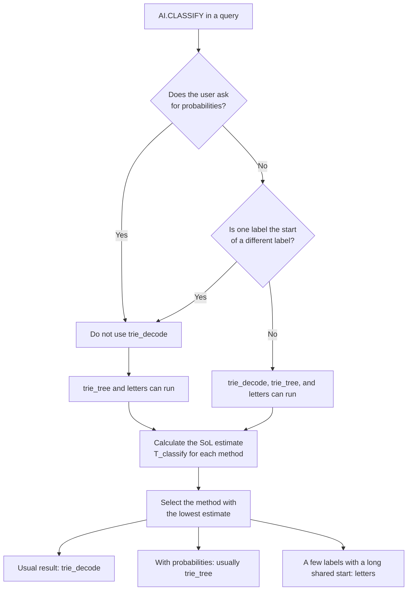

# "To Classify, Try a Trie Tree": An Explanation in ASD-STE100

Source: Shreya Shankar and Charles Frye, [To Classify, Try a Trie Tree](https://fsdatalab.github.io/blog/ai-classification/), Full Stack Data Lab, 12 October 2026.

This file explains the article and its figures. The text uses ASD-STE100 (Simplified Technical English) writing rules:

- Each sentence has one topic.
- Descriptive sentences have a maximum of 25 words.
- Each paragraph has a maximum of 6 sentences.
- The text uses the active voice and the simple present tense.
- Each word has one meaning. The text uses the same word for the same thing every time.
- Words that are not in the STE dictionary are Technical Names or Technical Verbs. Section 1 defines them.

The figures are the figures of the original article. Figure 7 is new. It is not in the article.

---

## 1. Technical Names

| Technical Name | Meaning in this file |
|---|---|
| LLM | A large language model. In the article, the LLM is Qwen3-4B-fp8. |
| Quail | The AI-SQL engine of the authors. Quail runs the LLM in its own inference engine. |
| AI.CLASSIFY | The SQL function that gives one label to one document. |
| document | The text that Quail classifies. In the example, a document is a support message. |
| label | One of the possible answers. The example has 10 labels. |
| token | The smallest unit of text that the LLM reads or writes. |
| prompt | All the tokens that Quail sends to the LLM for one document. |
| request | One prompt (or one continuation of a prompt) that Quail sends to the LLM. |
| forward pass | One run of the LLM on the GPU. One forward pass can contain tokens from many requests. |
| decode step | One forward pass that adds one token to a request. |
| trie | A tree that keeps each label as a path of tokens. Labels with the same first tokens share the start of the path. |
| node | One token in the trie. |
| branching node | A node with more than one child. At a branching node, the LLM must make a choice. |
| answer position | A token where Quail reads the scores that the LLM gives to the next token. |
| KV / KV cache | The keys and values that the LLM calculates for each token. Quail keeps them in GPU memory to use again. |
| output head | The last matrix of the LLM. It changes a hidden state into one score for each token in the vocabulary. |
| SoL estimate | Speed-of-light estimate. The lowest possible GPU time for the work. |
| trie_decode, trie_tree, letters | The three methods that Quail uses to do AI.CLASSIFY. |

---

## 2. Summary

AI.CLASSIFY gives one label to each document. Most systems let the LLM write a free answer. Then they parse the answer to find a label. This procedure uses many tokens. Also, the answer can contain no valid label.

Quail controls the LLM directly. Thus, Quail lets the LLM select only from the labels. Quail has three methods to do this:

1. **trie_decode** makes the label one token at a time. It runs the LLM only at branching nodes.
2. **trie_tree** scores all the labels in one request. It gives a probability for each label.
3. **letters** puts a letter before each label. The LLM selects one letter in one step.

The Quail optimizer calculates the cost of each method. Then it selects the method with the lowest cost. Usually, trie_decode has the lowest cost. If the user asks for probabilities, trie_tree is usually the best method.

On 12 classification queries in the QUAIL-B benchmark, Quail is 1.8 times faster than a vLLM baseline (geometric mean per query). In total, Quail is 2.1 times faster.

---

## 3. The AI.CLASSIFY Function

The example query sorts support messages into 10 topics:

```sql
SELECT m.id,
       AI.CLASSIFY(
         m.body,
         ARRAY['billing', 'refund request', 'refund status',
               'shipping delay', 'shipping damage',
               'shipping address change', 'product defect',
               'two-factor authentication issue', 'praise', 'other']
       ) AS topic
FROM messages m;
```

The function has three arguments:

- **input**: The document to classify.
- **categories**: 2 to 255 labels. Each label can have a description of 25 words or fewer.
- **options**: Optional settings:
  - `task_description`: Extra instructions for the LLM, 50 words or fewer.
  - `probabilities`: If this is true, Quail also returns one probability for each label. The sum of the probabilities is 1.
  - `selectivity`: An estimate of the fraction of rows that a condition on the label keeps. The optimizer uses this estimate. It does not change the labels.

Quail always returns one of the labels. You can also use AI.CLASSIFY in a WHERE clause, with `=` or `IN`. If the same AI.CLASSIFY is in SELECT and in WHERE, Quail runs it only one time.

---

## 4. The Three Methods

All three methods send one prompt for each document. The prompt starts with `DOCUMENT:` and the document. Then the prompt has a question and the list of labels. The prompt ends with the token `ANSWER:`. At `ANSWER:`, the LLM scores the first token of the answer.

### Figure 1. The prompts


**What the figure shows:**

- The left column is the prompt for trie_decode and for trie_tree. The question asks for a label. The label list contains only the label text.
- The right column is the prompt for letters. The question asks for a letter. Each label has a letter before it, from A to J.
- The green box is the `ANSWER:` token. This is the answer position.
- In the right column, an arrow goes from `ANSWER:` to 10 dashed boxes (A to J). These are the 10 tokens that the LLM scores.

**What the figure means:**

The two prompts are almost the same. The only differences are the question and the letters. The letters make the prompt longer. In the example, the letters add 23 tokens to each prompt. But the answer for letters is always one token. Thus, letters needs only one answer position.

### 4.1 trie_decode: make the label one token at a time

trie_decode is similar to the procedure of other systems. The LLM makes the label one token at a time. But at each step, the LLM can select only a token that continues a valid label.

### Figure 2. The label trie


**What the figure shows:**

- The root of the trie is `ANSWER:`, on the left.
- Each path from the root to the right is one label. For example, `shipping` → `address` → `change` is the label "shipping address change".
- Green nodes are branching nodes. There are three: `ANSWER:`, `refund`, and `shipping`.
- Nodes with a dark outline are the last token of a label. There are 10, one for each label.
- Gray nodes (for example, `address`, `product`, `two`, `-factor`) are in a label, but they are not the end of a label. They also do not branch.

**What the figure means:**

The LLM must make a choice only at a green node. At all other nodes, only one next token is possible. For example, after `shipping` → `address`, the next token must be `change`. Thus, trie_decode does not run the LLM at `address`. It stops when only one label is possible.

For example:

- If the LLM selects `product` at `ANSWER:`, the label must be "product defect". Quail needs 1 step.
- If the LLM selects `refund` at `ANSWER:`, the LLM must also select `request` or `status`. Quail needs 2 steps.

The word "two-factor" has two tokens: `two` and `-factor`. This fact is important for trie_tree (Section 4.2).

### Figure 3. The decode steps for 10 documents


**What the figure shows:**

- Each row is one document. Each document gets a different label.
- The left part is the prompt of each document: `DOCUMENT:`, the document, the question and labels, and `ANSWER:`.
- The **Step 0** column is the first token that the LLM selects at `ANSWER:`. Step 0 is in the same request as the prompt.
- The **Step 1** column is the second token. Only documents 2 to 6 have a step 1.
- The **Label** column is the final label.
- A green box is a token that Quail sends back to the LLM for the next step.
- A dashed box is the token that decides the label.

**What the figure means:**

Quail does each step for all the documents together, in one forward pass. At step 0, five documents (1, 7, 8, 9, 10) get a token that decides the label. These documents are complete. The other five documents get `refund` or `shipping`. These tokens do not decide the label. Thus, only these five documents go to step 1.

Look at document 8. The LLM selects `two`. Only one label starts with `two`. Thus, `two` decides the label "two-factor authentication issue" in one step.

If each label has the same probability, the mean number of requests per document is:

b = (5 × 1 + 5 × 2) / 10 = 1.5

**Limits of trie_decode:**

- trie_decode follows only one path. It does not score the other labels. Thus, it cannot give probabilities.
- trie_decode cannot select a label that is the start of a different label. For example, it cannot select "refund" if "refund request" is also a label. The reason is that no token means "stop".

For these cases, Quail must use trie_tree or letters.

### 4.2 trie_tree: score all labels in one request

trie_tree gives a probability for each label. The probability of a full label is the product of the probabilities of its tokens:

P(m) = P(x₁ | prompt) × P(x₂ | prompt, x₁) × … × P(xₜ | prompt, x₁ … xₜ₋₁)

But this formula gives a lower score to long labels. Each token multiplies the score by a number less than 1. This occurs also after the label is already decided. For example, the score of "shipping address change" includes P(`change`). But `change` is the only possible token after `address`.

Thus, trie_tree scores each label only up to the word where the label becomes different from all other labels:

| Label | Score |
|---|---|
| shipping address change | P(`shipping`) × P(`address` \| `shipping`) |
| product defect | P(`product`) |
| two-factor authentication issue | P(`two`) × P(`-factor` \| `two`) |

"two-factor" is one word with two tokens. Thus, trie_tree scores both tokens. If trie_tree scores only `two`, the score also includes other text that starts with `two`, for example "two days ago".

The sum of the 10 scores is not 1. The LLM also gives probability to tokens that are not in a label, for example `The`. The vocabulary has 151,936 tokens. Thus, Quail divides each score by the sum of all 10 scores. The result is the probability that Quail returns.

If one label is the start of a different label, Quail uses a special rule. For example, with "refund" and "refund request":

score(refund) = P(`refund`) × (1 − P(`request` | `refund`))

Without this rule, the probability of `refund` adds to the score of both labels.

In the example, trie_tree must run the LLM at 4 nodes: `ANSWER:`, `refund`, `shipping`, and `two`. These 4 nodes are in the same request as the prompt.

### Figure 4. The attention mask of trie_tree


**What the figure shows:**

- Each row is one of the 4 trie nodes: `ANSWER:`, `refund`, `shipping`, `two`.
- The left block of columns is the KV of the prompt.
- The right block has one column for each of the 4 trie nodes.
- A green cell means that the node in the row attends to the token in the column. A white cell means that it does not attend.

**What the figure means:**

- All 4 nodes attend to the full prompt KV.
- All 4 nodes attend to `ANSWER:`, because `ANSWER:` is on the path of each node.
- Each node attends to itself.
- `refund`, `shipping`, and `two` do not attend to each other. They are on different paths of the trie.

A simple procedure sends 4 requests, one for each node. Each request then reads the KV of the full prompt from GPU memory. Quail uses a custom tree attention kernel. The kernel puts the 4 nodes in one request, with this mask. Thus, the GPU reads the prompt KV only one time.

trie_tree always runs the LLM on the same number of tokens as trie_decode, or more. But trie_tree needs only one request for each document.

### 4.3 letters: score one token per label

letters changes each label into one token. The prompt shows "A: billing", "B: refund request", and continues to "J: other" (Figure 1, right). At `ANSWER:`, Quail reads the probabilities of the 10 letters. Then it divides each probability by the sum, so that the sum is 1. Quail selects the label with the highest probability.

letters needs no trie and no extra request. But it has two disadvantages:

- The prompt is longer, because each label line has a letter.
- The accuracy can change, because the LLM answers with a letter and not with the label.

### 4.4 Keep the document KV for later operators

A query often runs more than one AI operator on the same documents. For example, a query can classify the topic, keep only refund messages, and then classify the urgency. Each operator reads the same document.

Quail keeps the KV of each document in its KV cache. Thus, the next operator processes only its own question. GPU memory has a limit. When the memory is full, Quail removes the KV that saves the least work for each memory page.

---

## 5. Cost of Each Method

All Quail cost models use SoL estimates.

### 5.1 Request length

Each request contains:

1. The preamble (`DOCUMENT:`): q_pre tokens.
2. The document: ℓᵢ tokens.
3. The instruction (question and labels): q_tail tokens.
4. The answer positions: a tokens.

Thus:

- Request length: rᵢ = q_pre + ℓᵢ + q_tail + a
- Total tokens: n_tok = L₁ + N (q_pre + q_tail + a), where L₁ is the sum of all ℓᵢ
- Number of forward passes: K = ⌈n_tok / C⌉, where C is the token budget of one forward pass

The three methods are different only in q_tail and a:

| Method | q_tail | a |
|---|---|---|
| trie_decode | 66 | 1.5 |
| trie_tree | 66 | 4 |
| letters | 89 | 1 |

### 5.2 KV reads

Each answer position attends to the prompt. Thus, the GPU must read the prompt KV from memory.

- letters and trie_tree read the prompt KV one time for each document.
- trie_decode reads the prompt KV again for each step after step 0. Each such step is a new request.

### 5.3 Output head

The output head of Qwen3-4B has 151,936 rows (one for each token) of 2,560 values. If all labels have one token (letters), Quail calculates only the rows of the labels. Otherwise, Quail calculates all rows, because it must change the scores into probabilities. All rows cost approximately 2 × 2,560 × 151,936 ≈ 0.78 billion FLOPs for each answer position.

### 5.4 Extra work for each method (example)

| Method | Extra tokens for each document | Approximate extra FLOPs for each document |
|---|---|---|
| trie_decode | 1.5 answer positions | 1.5 × 8 billion ≈ 12 billion |
| trie_tree | 4 answer positions | 4 × 8 billion ≈ 32 billion |
| letters | 23 prompt tokens + 1 answer position | 23 × 7.2 billion ≈ 166 billion (the output head of 10 rows costs almost nothing) |
| (one document of 1,000 tokens) | — | ≈ 7,200 billion |

Each answer position costs approximately 8 billion FLOPs: 7.2 billion in the projections and the MLP, and 0.78 billion in the full output head.

The extra work is small when you compare it with the document. For 1,000 documents of 100 tokens, the difference between the methods is only 2% to 11%. The reason is that all methods must process the preamble, the document, and the instruction.

**Note:** The trie_decode estimate assumes that each forward pass is full of tokens. With only a few documents, a later decode step can run in an almost empty forward pass. Then trie_decode costs more than the estimate.

### Figure 7. How Quail selects a method (new figure)

This figure is not in the article. It shows the selection rules of Section 4.4 of the article.



**What the figure means:**

- trie_decode usually wins, because it adds the fewest tokens (1.5 for each document in the example).
- letters wins when a few labels have a long shared start. An example is 2 labels that are different only in the last word. The trie methods must run the LLM on each shared token.
- trie_tree usually wins when the query asks for probabilities.

---

## 6. Results on QUAIL-B

### Figure 6. QUAIL-B classification results


**Test conditions:**

- 12 classification queries on 5 data sets:
  - IMDB: movie reviews.
  - BIO: adverse drug event reports.
  - FEV: fact-check claims.
  - LEP: legal citations.
  - AGENT: agent traces.
- Each AI.CLASSIFY operator has 4 to 27 labels.
- LLM: Qwen3-4B-fp8, on one H100 GPU, scale factor 0.5.
- Baseline: vLLM v0.26.0 with prefix caching. The vLLM LLM writes the label, and then the authors parse it.

**What the figure shows:**

The figure has three panels. Each row is one query. A red dot is Quail. A gray dot is the vLLM baseline. A line connects the two dots of the same query.

1. **Input tokens/s** (left, logarithmic scale). Higher is better. A black vertical mark is the SoL estimate of Quail.
2. **KV regret (%)** (center). Lower is better. KV regret is the percentage of calculated tokens that the engine already calculated one time before. For example, this occurs when the engine removes the KV and must calculate it again.
3. **$ per query** (right, logarithmic scale). Lower is better.

**What the figure means:**

- **Speed.** The red dot is to the right of the gray dot on all 12 rows. Thus, Quail is faster on all 12 queries. The largest throughput is on BIO-6 (approximately 10 million tokens/s for Quail, approximately 2 million for vLLM).
- **Distance from SoL.** No red dot touches its black mark. Quail runs at 1.8 to 2.8 times its SoL estimate on each query.
- **KV regret.** Quail stays below approximately 6% on all queries. vLLM has a high regret on queries that read the same documents more than one time. AGENT-5 has the highest regret: 64%. AGENT-5 has three different AI.CLASSIFY operators on the same agent traces. vLLM removes the least recently used KV. Thus, when the next operator reads a trace, vLLM usually must calculate the trace again.
- **Cost.** The red dot is to the left of the gray dot on all rows. Thus, Quail costs less on all 12 queries.
- **Smaller differences.** On IMDB-11, BIO-5, FEV-11, and LEP-6, both engines have a low KV regret. On LEP-6, the regret of Quail is a little higher than the regret of vLLM. On these queries, the speed difference is smaller. The largest speed differences come from the KV that Quail keeps (Section 4.4).

---

## 7. Decision Models

A decision model is an LLM that answers a typed question. It returns a probability for each answer. It does not write text. Quail supports one open decision model, Decision 2.0 Kai 0.6B. This model is a fine-tuned version of Qwen3-0.6B.

### Figure 5. The prompt and decision head of Decision 2.0 Kai


**What the figure shows:**

- The large box on the left is the prompt. It contains `Context:`, the support message, the question "Classify the ticket.", and `Options:`.
- Each label has its own option block, for example `<option>{"key":"billing"}</option>`.
- The prompt ends with "Select the single option ..." and `Decision:`.
- The dashed green boxes are the tokens where the decision head reads the hidden state. There is one at the end of each option block (`</option>`) and one at `Decision:`.
- Arrows go from these tokens into the **Decision head**.
- The decision head gives one probability for each label: P(billing), P(refund request), and continues to P(other).

**What the figure means:**

The LLM runs on the full prompt one time. The decision head then uses two types of hidden state:

- hₘ: the hidden state of the last token of option block m.
- q: the hidden state of the last token of the prompt (`Decision:`).

The decision head first scales hₘ and q to a similar range. Then it calculates one score sₘ for each label:

sₘ = (W_h h̄ₘ · W_q q̄) / √d + w · GELU(U_h h̄ₘ + U_q q̄ + b)

The first term is a dot product, as in attention. The second term is a very small neural network. A softmax then changes the scores into probabilities. The decision head has approximately 1 million weights. The LLM has approximately 600 million weights. Thus, the decision head costs almost nothing.

**Comparison with trie_tree:**

- Both give probabilities in one request.
- trie_tree must score all 151,936 vocabulary tokens at each answer position. The decision head scores only the M labels.
- The option blocks add approximately 16 tokens for each label. In the example, this is approximately 190 tokens for each document. letters adds only 24.
- But accuracy increases. On the 12 QUAIL-B queries, Decision 2.0 Kai agrees with the reference labels on 63.1% of documents. The base Qwen3-0.6B agrees on only 39.0%.

---

## 8. Conclusion

Quail runs the LLM in its own inference engine. Thus, it can make the LLM select only from the labels. It has three methods, and it selects the method with the lowest cost:

| Method | Requests for each document | Probabilities | Best use |
|---|---|---|---|
| trie_decode | 1 or more (1.5 in the example) | No | Default |
| trie_tree | 1 | Yes | When the user asks for probabilities |
| letters | 1 | Yes | A few labels with a long shared start |
| Decision 2.0 Kai | 1 | Yes | Small model with higher accuracy than its base model |

Usually, the best answer is a trie. Use trie_decode by default. Use trie_tree when the query asks for probabilities.
